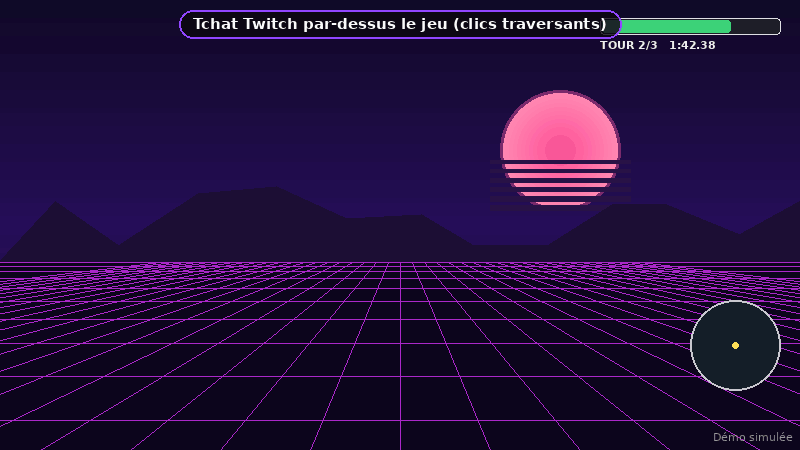

# Tchat Overlay

Le tchat Twitch par-dessus le jeu, sur l'écran principal. Fenêtre transparente, toujours au premier plan, clics traversants. Livré en un seul `.exe` autonome pour Windows.

*Animation simulée à titre d'illustration.*

## Fonctions

- Tchat par-dessus le jeu, déplaçable et redimensionnable (`Ctrl+Shift+F10`)
- Connexion avec un compte Twitch (ou lecture anonyme)
- Multi-tchat avec étiquette colorée par chaîne
- Avatars des viewers, emotes Twitch animées
- Bandeau défilant horizontal
- Thèmes sombre / clair, catégories de réglages repliables
- **Édition Pro :** barre de réponse modulable, mode interactif (clic sur les messages), options modérateur (supprimer, timeout, ban, modes du tchat)

## Téléchargement

| Édition | Lien | Contenu |
|---|---|---|
| **Tchat Overlay** | [Télécharger Tchat_Overlay.exe](../../releases/latest/download/Tchat_Overlay.exe) | Tchat par-dessus le jeu (lecture) |
| **Tchat Overlay Pro** | [Télécharger Tchat_Overlay_Pro.exe](../../releases/latest/download/Tchat_Overlay_Pro.exe) | + barre de réponse, mode interactif, modération |

[Toutes les versions](../../releases) · [Empreintes SHA-256](../../releases/latest/download/SHA256SUMS.txt)

Un seul `.exe` autonome (environ 70 Mo), aucune installation. Windows 10 (20H1+) ou 11, 64 bits.

## Démarrage rapide

1. Créer une application sur https://dev.twitch.tv/console (redirection `http://localhost`, type de client **Public**), copier le Client-ID.
2. Lancer le .exe, coller le Client-ID dans Paramètres > Connexion, cliquer **Se connecter avec Twitch**.
3. `Ctrl+Shift+F10` pour placer le tchat, puis à nouveau pour verrouiller.

Le jeu doit être en plein écran fenêtré ou sans bordure.

## Documentation

[Notice complète](docs/NOTICE.md) : installation, connexion, paramètres, édition Pro, raccourcis, fichiers, dépannage, compilation.

## Compilation

SDK .NET 10, puis `build.bat`, ou push sur `main` (GitHub Actions compile les deux éditions).

Nouvelle version publiée : pousser un tag, par ex. `git tag v1.0.1 && git push origin v1.0.1`. Le workflow crée la Release avec les deux `.exe` ; les liens ci-dessus pointent toujours vers la dernière.
