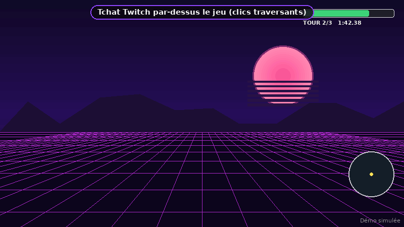

# Notice — Tchat Overlay

Tchat Overlay affiche le tchat Twitch par-dessus le jeu, sur l'écran principal. La fenêtre est transparente, toujours au premier plan et traversée par la souris : les clics vont au jeu.



*Animation simulée à titre d'illustration.*

## Sommaire

1. [Éditions](#1-éditions)
2. [Installation](#2-installation)
3. [Connexion du compte Twitch](#3-connexion-du-compte-twitch)
4. [Utilisation](#4-utilisation)
5. [Paramètres](#5-paramètres)
6. [Édition Pro : barre de réponse](#6-édition-pro--barre-de-réponse)
7. [Édition Pro : mode interactif et modération](#7-édition-pro--mode-interactif-et-modération)
8. [Raccourcis clavier](#8-raccourcis-clavier)
9. [Fichiers](#9-fichiers)
10. [Dépannage](#10-dépannage)
11. [Compilation](#11-compilation)

---

## 1. Éditions

| Fonction | Tchat Overlay | Tchat Overlay Pro |
|---|:---:|:---:|
| Tchat par-dessus le jeu, clics traversants | oui | oui |
| Multi-tchat, avatars, emotes animées | oui | oui |
| Bandeau défilant horizontal | oui | oui |
| Thèmes sombre / clair | oui | oui |
| Barre de réponse modulable | non | oui |
| Mode interactif (clic sur les messages) | non | oui |
| Options modérateur | non | oui |

Les deux éditions partagent la même configuration et le même compte. Elles ne peuvent pas tourner en même temps.

Droits demandés à Twitch :
- **Standard :** `chat:read` (lecture seule).
- **Pro :** `chat:read`, `chat:edit`, `moderator:manage:banned_users`, `moderator:manage:chat_messages`, `moderator:manage:chat_settings`.

Après un passage de Standard à Pro, reconnecter le compte une fois (Paramètres > Connexion) pour accorder les nouveaux droits.

## 2. Installation

1. Télécharger l'édition voulue (dernière version) :
   - [Tchat_Overlay.exe](../../../releases/latest/download/Tchat_Overlay.exe) : Standard
   - [Tchat_Overlay_Pro.exe](../../../releases/latest/download/Tchat_Overlay_Pro.exe) : Pro
   - [Toutes les versions](../../../releases)
2. Placer le fichier où vous voulez. Aucune installation, aucun runtime .NET à ajouter.
3. Lancer le programme. Une icône apparaît dans la zone de notification (à côté de l'horloge).

Configuration requise :
- Windows 10 (20H1 ou plus récent) ou Windows 11, 64 bits.
- Jeu en **plein écran fenêtré** ou **sans bordure**. En plein écran exclusif, Windows n'affiche aucune fenêtre par-dessus le jeu.

Au premier lancement, Windows SmartScreen peut afficher « Windows a protégé votre ordinateur » (programme non signé) : cliquer « Informations complémentaires » puis « Exécuter quand même ».

## 3. Connexion du compte Twitch

### 3.1 Créer une application Twitch (une seule fois)

1. Ouvrir https://dev.twitch.tv/console, onglet **Applications**, bouton **Enregistrer votre application**.
2. Remplir :
   - **Nom :** au choix, unique sur Twitch (ex. `TchatOverlay-MonPseudo`).
   - **URL de redirection OAuth :** `http://localhost`
   - **Catégorie :** Application Integration
   - **Type de client :** **Public**
3. Valider, puis copier le **Client-ID**.

### 3.2 Se connecter

1. Paramètres > **Connexion** : coller le Client-ID.
2. Cliquer **Se connecter avec Twitch**.
3. Un code s'affiche dans la fenêtre et le navigateur s'ouvre sur la page Twitch.
4. Vérifier que le code est le même, puis cliquer **Autoriser**.
5. La fenêtre affiche « Connecté : votre_pseudo » et le tchat démarre.

Le bouton devient **Se déconnecter**, ce qui annule aussi l'accès côté Twitch.

### 3.3 Sécurité

- Les jetons d'accès sont chiffrés avec le compte Windows (DPAPI) : illisibles depuis une autre session ou un autre PC.
- L'accès est vérifié toutes les 50 minutes et renouvelé automatiquement.
- Sans compte connecté, le tchat reste lisible en mode anonyme, sans avatars ni fonctions Pro.

## 4. Utilisation

### 4.1 Icône de la zone de notification

- **Double-clic :** ouvre les Paramètres.
- **Clic droit :** menu.

| Entrée du menu | Effet |
|---|---|
| Mode édition | Déplacer / redimensionner l'overlay |
| Afficher / masquer | Cache ou montre le tchat |
| Écrire dans le tchat *(Pro)* | Ouvre la barre de réponse |
| Mode interactif *(Pro)* | Rend les messages cliquables |
| Paramètres... | Fenêtre de réglages |
| Vider le tchat | Efface l'affichage local (pas le tchat Twitch) |
| Reconnecter | Relance la connexion |
| Ouvrir config.json | Ouvre le fichier dans l'éditeur |
| Recharger config.json | Applique une modification faite à la main |
| Ouvrir le dossier de configuration | Ouvre `%AppData%\Tchat Overlay` |
| Ouvrir le dossier des avatars | Ouvre les photos de profil téléchargées |
| Quitter | Ferme le programme |

### 4.2 Placer le tchat

1. `Ctrl+Shift+F10` : mode édition. Un cadre violet apparaît.
2. Glisser pour déplacer, tirer le coin bas-droit pour redimensionner.
3. `Ctrl+Shift+F10` à nouveau : verrouillé. La position est enregistrée.

La position peut aussi se saisir au pixel près dans Paramètres > Position et taille.

## 5. Paramètres

Chaque catégorie se plie ou se déplie en cliquant sur son titre. Boutons **Tout développer** / **Tout réduire** en haut. **Appliquer** = aperçu immédiat, **OK** = enregistrer, **Annuler** = revenir à l'état d'ouverture (sauf le compte).

### Connexion
- **Client-ID**, **Compte** : voir section 3.
- **Chaîne Twitch :** chaîne affichée. Vide = chaîne du compte connecté. Accepte un pseudo ou une URL `twitch.tv/...`.

### Multi-tchat
- **Activer le multi-tchat** et **Chaînes supplémentaires** (séparées par des virgules).
- **Afficher le nom de la chaîne :** étiquette colorée devant chaque message, une couleur fixe par chaîne.

### Interface
- **Thème de cette fenêtre :** Système, Sombre ou Clair. La barre de titre suit le thème.

### Position et taille
- Gauche, Haut, Largeur, Hauteur, en pixels.

### Apparence
| Réglage | Effet |
|---|---|
| Thème du tchat | Sombre ou Clair : applique un préréglage de couleurs |
| Police, Taille du texte | Police système et taille |
| Couleur du texte, Fond des messages, Fond du cadre | Format `#AARRGGBB` (AA = opacité : `00` invisible, `FF` opaque). Bouton `...` = sélecteur |
| Arrondi des bulles | Rayon des coins |
| Opacité générale | 0,1 à 1 |
| Ombre portée du texte | Lisibilité sur fond clair ou chargé |
| Couleurs des pseudos Twitch | Couleur choisie par chaque viewer |
| Éclaircir les pseudos sombres | Ajuste les pseudos peu lisibles selon le thème |
| Couleur pseudo par défaut | Si les couleurs Twitch sont désactivées |
| Afficher les emotes, Emotes animées | Emotes Twitch (fixes ou GIF) |
| Afficher les avatars, Avatars ronds | Photo de profil devant le pseudo |
| Nouveaux messages en haut | Inverse l'ordre |

### Défilement horizontal
- **Activer le bandeau défilant :** messages sur une ligne, de droite à gauche.
- **Vitesse** (px/s) et **Espace entre messages** (px).
- Réduire la hauteur de la fenêtre à environ 40 px.
- Dans ce mode, « Messages max » = file d'attente ; la durée d'affichage est ignorée.

### Comportement
- **Durée d'affichage :** secondes avant disparition (0 = permanent).
- **Messages max à l'écran.**
- **Masquer les commandes (!...)**, **Afficher les messages système**, **Pseudos ignorés** (bots, etc.).

### Barre de réponse *(Pro)* et Modération *(Pro)*
Voir sections 6 et 7.

### Fichiers
- Chemin de `config.json` et bouton pour ouvrir le dossier.

### Raccourcis globaux
- Format : `Ctrl`, `Shift`, `Alt`, `Win` + une touche (ex. `Alt+F9`, `Ctrl+Shift+K`).
- Si un raccourci est déjà pris par un autre programme, une notification le signale.

## 6. Édition Pro : barre de réponse

### Écrire
1. `Ctrl+Shift+F9` : la barre s'ouvre avec le clavier dedans.
2. Taper le message, **Entrée** pour envoyer.
3. La barre se ferme et le focus revient au jeu.

| Touche | Effet |
|---|---|
| Entrée | Envoyer |
| Échap | Fermer sans envoyer, retour au jeu |
| Flèche haut | Rappeler les messages précédents |

- En multi-tchat, une liste déroulante choisit la chaîne de destination.
- Vos propres messages s'affichent dans l'overlay (Twitch ne les renvoie pas).
- 500 caractères maximum ; un compteur apparaît après 400.

### Commandes
| Commande | Effet |
|---|---|
| `/me texte` | Message d'action (italique) |
| `/timeout pseudo [secondes] [raison]` | Timeout (600 s par défaut) |
| `/untimeout pseudo` ou `/unban pseudo` | Lever un timeout ou un ban |
| `/ban pseudo [raison]` | Bannissement définitif |
| `/clear` | Vider le tchat de la chaîne |
| `/slow [secondes]` / `/slowoff` | Mode lent (3 à 120 s) |
| `/emoteonly` / `/emoteonlyoff` | Emotes uniquement |
| `/followers` / `/followersoff` | Followers uniquement |
| `/subscribers` / `/subscribersoff` | Abonnés uniquement |
| `/aide` | Liste des commandes |

### Réglages (Paramètres > Barre de réponse)
- **Toujours visible :** sinon, la barre n'apparaît qu'à l'ouverture.
- **Rendre le focus au jeu après envoi.**
- **Afficher mes messages dans l'overlay.**
- **Quitter le mode interactif après un clic Répondre.**
- **Largeur**, **Gauche / Haut** (vide = centrée en bas de l'écran), **Taille du texte**, **Fond**, **Couleur du texte**, **Opacité**.
- Déplacement et largeur à la souris : mode édition (`Ctrl+Shift+F10`).

## 7. Édition Pro : mode interactif et modération

### Mode interactif
`Ctrl+Shift+F8` : cadre bleu autour du tchat, les messages deviennent cliquables. Le défilement automatique (disparition) est mis en pause. `Ctrl+Shift+F8` à nouveau pour revenir aux clics traversants.

- **Clic sur un message :** ouvre la barre de réponse en réponse à ce message (« Réponse à @pseudo »).
- **Clic droit sur un message :**
  - Répondre, Copier le message, Copier le pseudo
  - Supprimer le message
  - Timeout (durées réglables)
  - Bannir (confirmation demandée)
  - Débannir / lever le timeout

### Bouton « Modération » de la barre
- Mode lent, Emotes uniquement, Followers uniquement, Abonnés uniquement (les modes actifs sont cochés).
- Vider le tchat (confirmation demandée).

### Réglages (Paramètres > Modération)
- **Activer les options modérateur.**
- **Durées de timeout :** en secondes, séparées par des virgules (défaut `60, 600, 3600`).
- **Confirmer avant de bannir.**
- **Mode lent :** durée utilisée par le bouton Modération (3 à 120 s).

Les actions de modération n'apparaissent que sur les chaînes où le compte connecté est **modérateur ou propriétaire**. Chaque action affiche une ligne de confirmation (ou l'erreur Twitch) dans le tchat.

## 8. Raccourcis clavier

| Raccourci | Effet | Édition |
|---|---|---|
| `Ctrl+Shift+F10` | Mode édition (déplacer / redimensionner) | Toutes |
| `Ctrl+Shift+F11` | Afficher / masquer | Toutes |
| `Ctrl+Shift+F9` | Barre de réponse | Pro |
| `Ctrl+Shift+F8` | Mode interactif | Pro |

Tous modifiables dans Paramètres > Raccourcis globaux.

## 9. Fichiers

Tout est rangé dans `%AppData%\Tchat Overlay` (accès : `Win + R`, taper `%AppData%\Tchat Overlay`, Entrée).

| Fichier | Contenu |
|---|---|
| `config.json` | Tous les paramètres (modifiable à la main, puis « Recharger config.json ») |
| `avatars\pseudo_id.png` | Photos de profil, rafraîchies tous les 7 jours |
| `erreurs.log` | Erreurs éventuelles |

Les clés `AccessToken`, `RefreshToken` et `AccountLogin` concernent le compte connecté : ne pas les modifier.

Pour tout réinitialiser : quitter le programme, supprimer le dossier `%AppData%\Tchat Overlay`.

## 10. Dépannage

| Problème | Solution |
|---|---|
| Le tchat n'apparaît pas au-dessus du jeu | Passer le jeu en plein écran fenêtré / sans bordure |
| « Déjà lancé » au démarrage | Une édition tourne déjà : la quitter depuis l'icône de notification |
| « Raccourci déjà utilisé » | Choisir une autre combinaison dans Paramètres > Raccourcis globaux |
| Pas d'avatars | Connecter un compte Twitch (le mode anonyme n'affiche pas les avatars) |
| « Droits manquants » (Pro) | Paramètres > Connexion : Se déconnecter puis Se connecter avec Twitch |
| « Session Twitch expirée » | Se reconnecter dans Paramètres > Connexion |
| Actions de modération absentes | Le compte n'est pas modérateur de cette chaîne |
| La barre de réponse ne prend pas le clavier | Jeu en plein écran exclusif : passer en fenêtré sans bordure |
| Emotes 7TV / BTTV / FFZ non affichées | Non prises en charge : seules les emotes Twitch le sont |
| Erreur inexpliquée | Consulter `%AppData%\Tchat Overlay\erreurs.log` |

## 11. Compilation

Prérequis : SDK .NET 10 (Windows).

**GitHub Actions :** chaque push sur `main` compile les deux éditions. Onglet **Actions** > dernier build > artefacts `Tchat Overlay` et `Tchat Overlay Pro`.

**Publier une version :** pousser un tag `vX.Y.Z` (ex. `git tag v1.0.1 && git push origin v1.0.1`). Le workflow crée une Release avec `Tchat_Overlay.exe`, `Tchat_Overlay_Pro.exe` et `SHA256SUMS.txt` ; les liens de téléchargement pointent toujours vers la dernière Release.

**En local :** lancer `build.bat`.
- `publish\standard\Tchat Overlay.exe`
- `publish\pro\Tchat Overlay Pro.exe`

Commandes manuelles :
```
dotnet publish src/TchatOverlay.csproj -c Release -o publish/standard
dotnet publish src/TchatOverlay.csproj -c Release -p:Edition=Pro -o publish/pro
```

Client-ID intégré (facultatif) : renseigner `BuiltInClientId` dans `src/TwitchAuth.cs` avant compilation. Les utilisateurs n'auront plus à créer d'application Twitch. Un Client-ID n'est pas secret.

L'animation de démo se régénère avec `python tools/make_demo_gif.py docs/demo.gif` (Pillow requis).
